# 해병대 전사(戰史) 디지털 연표

> 엑셀 한 장과 사진 폴더만 있으면, 6·25전쟁부터 연평도 포격전까지 해병대 전투사를 **연표 + 교육용 슬라이드** 웹사이트로 자동 변환해 주는 도구입니다.
> 설치도, 서버도, 인터넷 연결도 필요 없습니다.

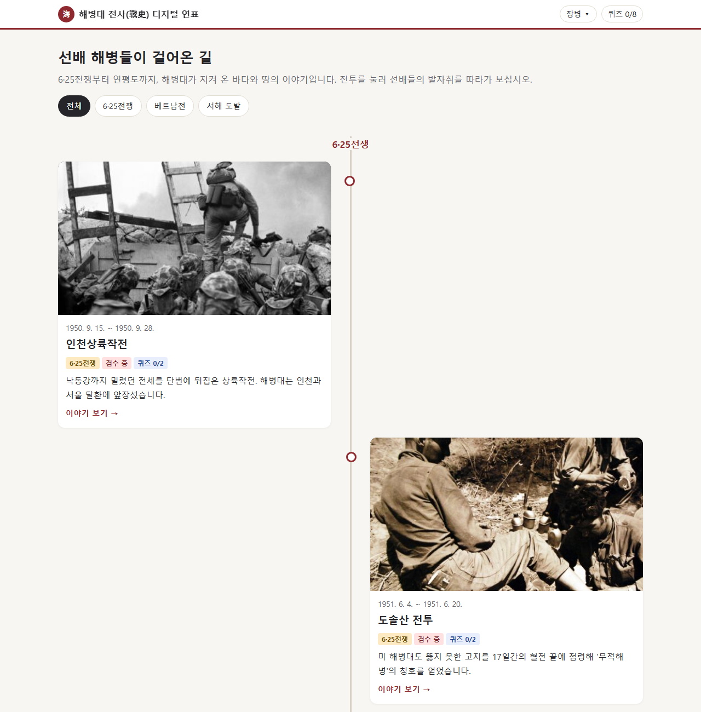

> 📊 **발표 자료**: [docs/발표자료.pptx](docs/발표자료.pptx) · [PDF](docs/발표자료.pdf) (10장)

---

## 1. 프로젝트 개요

### 1.1 배경
- 해병대 군사연구소는 역사관·박물관 소장 전사 자료를 스캔하고 있습니다. 현재 약 200점이 디지털화되어 있습니다.
- 하지만 자료가 **흩어져 있고**, 후배 장병과 교육생이 **관심을 갖고 볼 수 있는 형태로 전달되지 않습니다.**
- 전문연구관 3명이 웹 개발 없이도 자료를 계속 추가할 수 있는 방법이 필요했습니다.

### 1.2 목표
| 구분 | 내용 |
|---|---|
| 사용자가 얻는 것 | 한 전투의 흐름(왜, 어떻게, 결과와 의의)을 **3분 안에 이해**한다 |
| 열람자 | 장병, 간부 교육생, 역사관 방문객 (현장 약 2,000명, 온라인 10만 명 이상 목표) |
| 작성자 | 전문연구관 3명 (엑셀로만 작업) |
| 제약 | 하루 안에 개발, 로그인·결제·서버 없음, 인터넷 없이 동작 |

### 1.3 시범판 수록 전투
| 전쟁 | 전투 | 시기 |
|---|---|---|
| 6·25전쟁 | 인천상륙작전 | 1950. 9. |
| 6·25전쟁 | 도솔산 전투 | 1951. 6. |
| 베트남전 | 짜빈동 전투 | 1967. 2. |
| 서해 도발 | 연평도 포격전 | 2010. 11. |

> 전투 문구는 공개 자료를 바탕으로 LLM이 쓴 **초안**이며, 화면에 "검수 중"으로 표시됩니다. 군사연구소장의 검수를 거쳐 확정됩니다.

---

## 2. 주요 기능

| # | 기능 | 설명 |
|---|---|---|
| F1 | **전투 연표** | 전투를 시간순 세로 연표로 보여 줍니다. 카드마다 대표 사진과 한 줄 요약이 있고, 전쟁 구분으로 걸러 볼 수 있습니다. 휴대폰과 PC를 모두 지원합니다. |
| F2 | **전투 상세 + 교육 모드** | 개요, 단계별 경과, 사진(출처 포함), 의의·교훈을 한 화면에서 읽습니다. **[교육 모드]** 버튼을 누르면 같은 내용이 전체화면 슬라이드로 바뀌어 강의에 바로 쓸 수 있습니다. |
| F3 | **엑셀 → 사이트 변환기** | 엑셀과 이미지 폴더를 끌어다 놓으면 입력 검사, 사진 축소(1600px), "해병대 군사연구소" 워터마크, 비공개 자료 제외를 거쳐 `site.zip`을 만들어 줍니다. |
| F4 | **대상자별 보기 + 퀴즈** (v0.2) | 첫 화면에서 **장병 / 간부·교육생 / 일반 방문객**을 고르면 연표 소개, 들어가는 말, 의의·교훈, 퀴즈가 대상에 맞게 바뀝니다. 경과 중간과 끝의 OX·4지선다 퀴즈는 바로 채점하고 해설을 보여 주며, 모두 풀면 **"전사 탐구 완료" 배지**가 나옵니다. 본문 용어(교두보, 백병전 등)는 누르면 풀이가 나옵니다. |

| F5 | **살아 있는 기록** (v0.3) | ① **개정 이력**: 전투마다 "최근 수정일"과 이력을 보여 주고, 전체 개정 이력 화면을 둡니다. ② **근거·신뢰 수준**: 개요와 경과마다 `확인` / `추정` / `기록마다 다름` 표시와 각주를 달고, 하단에 근거 목록을 보여 줍니다. ③ **"지휘관이라면?" 결심 시나리오**: 중요한 순간에 선택지를 주고, 고르면 선택지별 장단점과 **실제 결심·결과**를 비교합니다. 교육 모드에서는 토의한 뒤 실제 결심을 공개합니다. |
| F6 | **AI 쉬운 설명** (v0.4, 온라인판 전용) | 전투 상세 화면의 **[AI로 쉽게 풀어보기]** 버튼을 누르면 Google Gemini가 그 전투 본문만 근거로 **선택한 대상자 눈높이의 3줄 설명**을 만듭니다. 호출은 서버 함수(`api/explain.js`)에서만 하고 API 키는 서버 환경변수에만 둡니다. 브라우저는 전투 ID와 대상자만 보내므로 임의 질문에 쓸 수 없습니다. 추모 전투는 정중한 어조로 씁니다. 더블클릭으로 연 오프라인판에서는 버튼이 나오지 않습니다. |

> **F5를 만든 이유**: 디지털화한 전사 자료는 **일방향**이고 **변화를 담지 못한다**는 문제 제기에서 출발했습니다. 역사 서술이 연구에 따라 바뀐다는 것을 숨기지 않고 드러내고(개정·근거), 열람자가 읽기만 하지 않고 직접 판단해 보게(결심) 했습니다.

**딱딱하지 않게, 그러나 가볍지 않게**
- 문장은 이야기체(~습니다)로 쓰고, "알고 계셨나요?" 같은 질문형 도입을 넣었습니다. 연표 카드는 스크롤하면 하나씩 나타납니다.
- 다만 **전사자가 있는 전투**(연평도 포격전)는 엑셀의 `추모문구`가 있으면 추모 띠를 표시하고, 축하 효과를 빼서 차분한 톤을 유지합니다.

**밝고 차분한 화면** (소장 요청: "너무 어둡지 않고 화려하지 않게")
- 흰 바탕 헤더에 가는 진홍색 선만 남기고, 해병대 상징색(진홍·황금)은 채도를 낮춰 강조에만 씁니다.
- 검은 바탕이던 **교육 모드와 결심 카드를 밝은 미색 바탕**으로 바꿨습니다. 강의실 프로젝터에서도 짙은 글자가 잘 읽힙니다.
- 이모지(🪖🎖️🏅🎉⚔️🎗️)는 **단색 선 아이콘이나 글자**로 바꾸고, 카드가 튀어 오르는 효과와 정답 애니메이션은 줄이거나 없앴습니다.
- 색상은 `src/site-template.html` 스타일 맨 끝의 "차분한 화면" 블록 한곳에 모아 두어, 나중에 바꾸기 쉽습니다.

### 실행 화면

| 첫 화면: 대상자 선택 | 전투 상세 (간부 모드) |
|---|---|
| 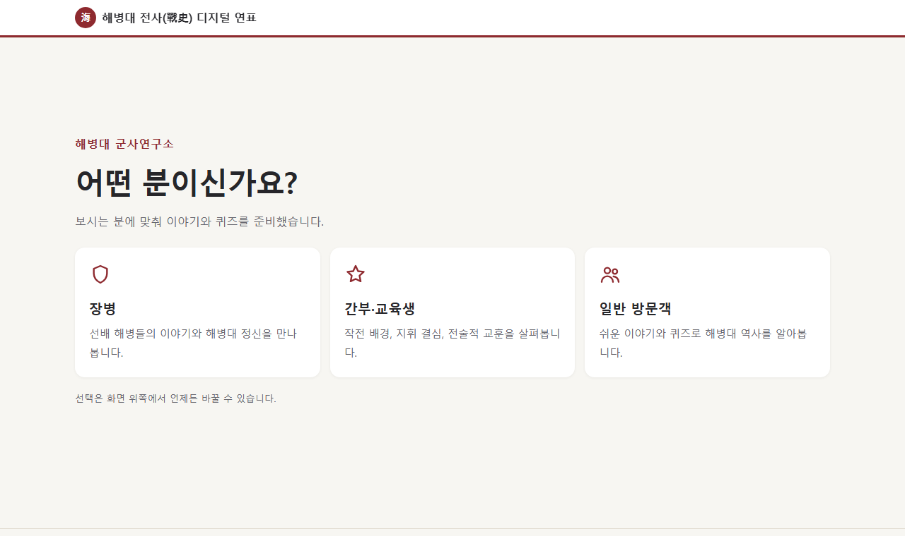 | 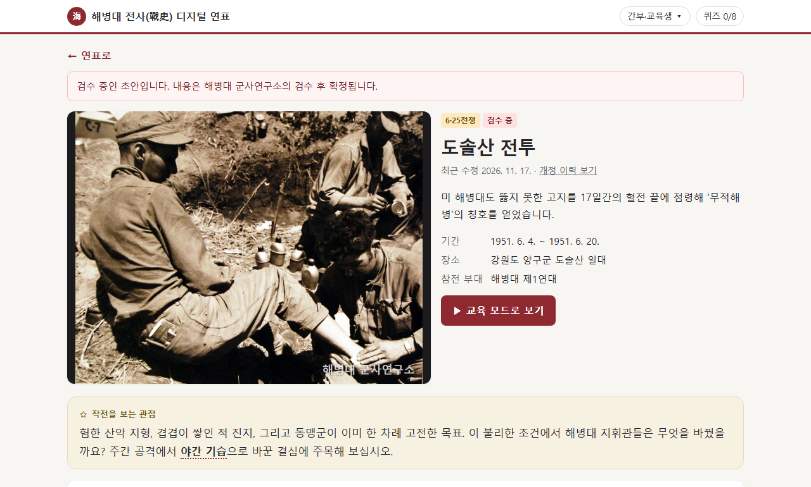 |
| **결심 카드와 퀴즈** | **근거와 신뢰 수준** |
| 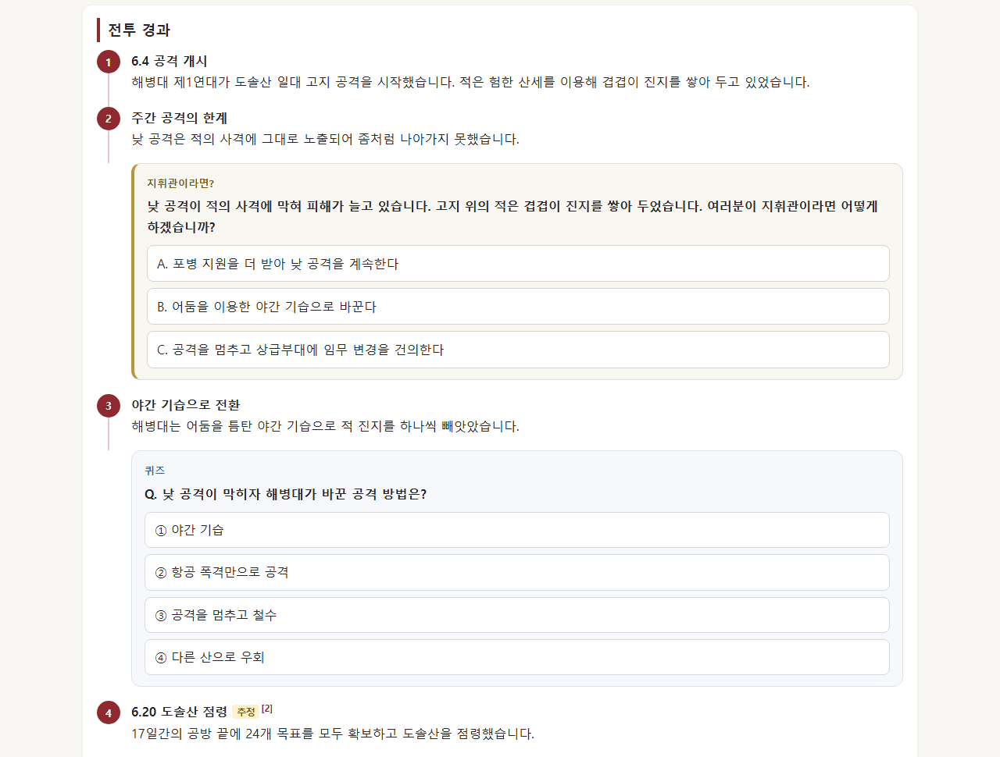 | 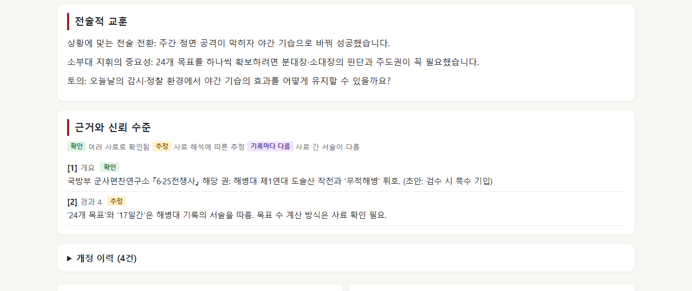 |
| **교육 모드: 표지** | **교육 모드: 결심 공개** |
| 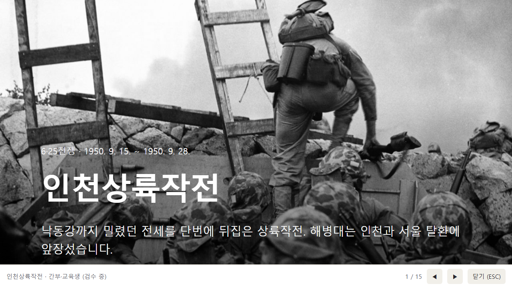 | 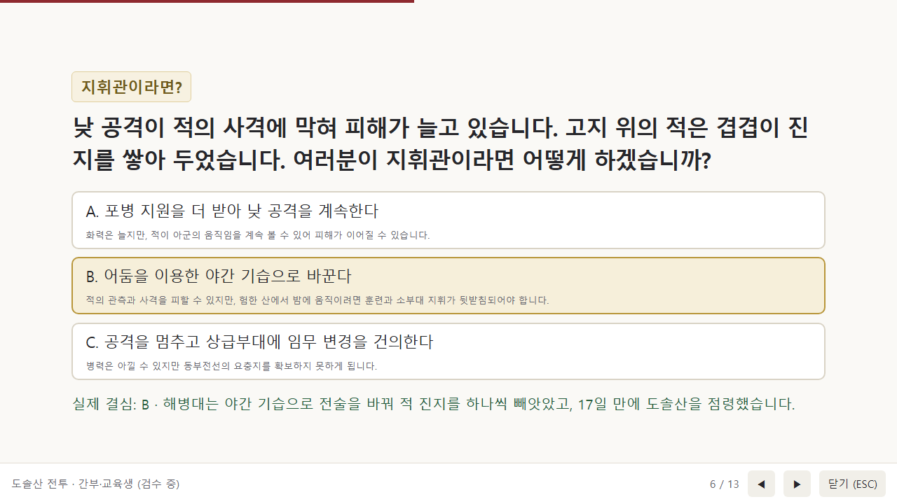 |
| **교육 모드: 퀴즈 정답 공개** | **추모 톤 (연평도 포격전)** |
| 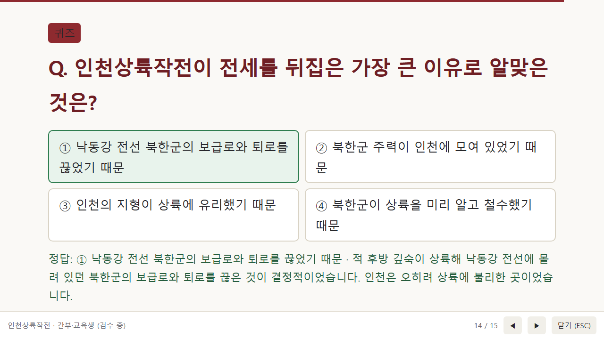 | 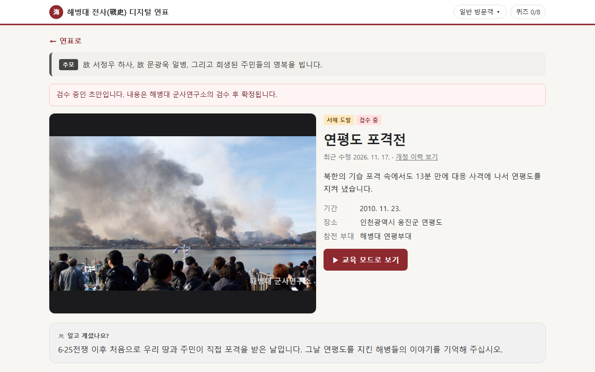 |
| **전체 개정 이력** | **변환기 입력 검사** |
| 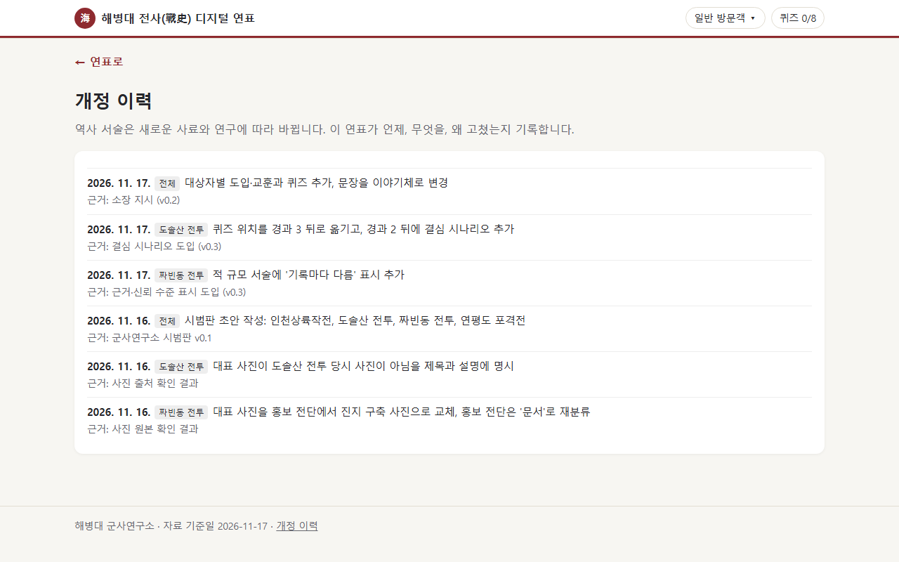 | 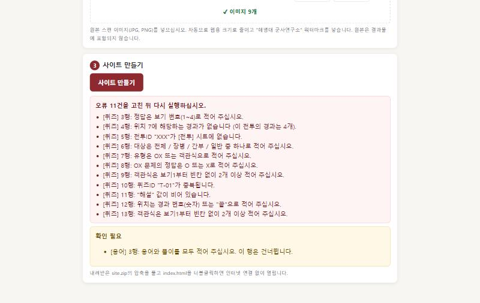 |

**주소 옵션** (대상자별 QR코드, 강의 바로가기에 사용)
- `index.html?aud=soldier` / `officer` / `public`: 대상자 선택을 건너뛰고 해당 모드로 바로 엽니다.
- `index.html?aud=officer&edu=6#/b/DSS`: 도솔산 전투의 교육 모드 6번째 슬라이드로 바로 엽니다. `&reveal=1`을 붙이면 정답이나 결심을 공개한 상태로 엽니다.

---

## 3. 시스템 구조

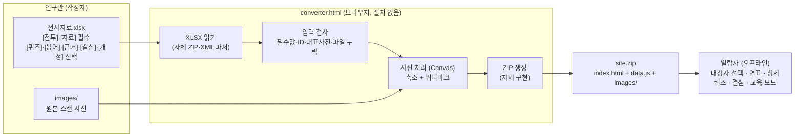

### 설계 포인트
- **외부 라이브러리 0개**: 엑셀(.xlsx)은 ZIP 안의 XML이므로 브라우저 내장 `DecompressionStream`과 `DOMParser`로 직접 읽습니다. 결과 ZIP도 직접 만듭니다. 그래서 인터넷이 없는 군 PC에서도 동작합니다.
- **데이터는 `data.js`로 전달**: `file://`로 연 페이지는 `fetch()`로 JSON을 읽을 수 없습니다. 그래서 데이터를 `<script src="data.js">`로 불러옵니다. 덕분에 `index.html`을 더블클릭하기만 하면 열립니다.
- **화면 1개, 보기 2가지**: 상세 화면과 교육 모드가 같은 데이터를 쓰므로, 연구관은 한 번만 입력하면 됩니다.
- **원본 보호**: 결과물에는 축소하고 워터마크를 넣은 사진만 들어갑니다. 원본 고해상도 파일은 들어가지 않습니다.

---

## 4. 폴더 구조

```
├─ README.md                  ← 이 문서
├─ requirements.txt           ← 의존성 목록 (외부 패키지 없음)
├─ docs/
│  ├─ PRD_해병대_전사_디지털_연표.md   ← 기획 문서
│  ├─ 발표자료.pptx / 발표자료.pdf     ← 발표 자료 (10장)
│  ├─ 발표자료_초안.md                 ← 발표 자료 구성안
│  ├─ 시험운용_결과.md                 ← 실제 사용 시나리오 시험 결과
│  └─ screenshots/                     ← 실행 결과 화면 (11장)
├─ converter/                 ← 변환기 (연구관용)
│  ├─ converter.html          ← 브라우저로 열어 사용
│  ├─ converter.js            ← XLSX 읽기·검사·사진 처리·ZIP 생성
│  ├─ site-template.js        ← 사이트 템플릿 (빌드 결과물)
│  └─ 전사자료_양식.xlsx       ← 빈 입력 양식
├─ 전사자료/                   ← ★ 샘플 입력 데이터
│  ├─ 전사자료.xlsx            ← [전투] 4개, [자료] 10건(비공개 예시 1건 포함), [퀴즈] 16문항, [용어] 9개
│  └─ images/                 ← 샘플 사진 9장
├─ site/                      ← ★ 샘플 출력 (변환기로 만든 결과 사이트)
│  ├─ index.html
│  ├─ data.js
│  └─ images/full, images/thumb
├─ src/
│  └─ site-template.html      ← 사이트 화면 원본 (대상자 선택·연표·상세·퀴즈·교육 모드)
├─ tests/                     ← ★ 입력 검사용 샘플
│  ├─ cases.json              ← 검사 항목과 기대 메시지
│  ├─ 오류검사_퀴즈.xlsx       ← 퀴즈 오류 11종
│  ├─ 오류검사_근거결심개정.xlsx ← 근거·결심·개정 오류 15종
│  └─ 정상_퀴즈용어시트없음.xlsx ← 이전 형식 호환 확인
└─ tools/
   ├─ build.ps1               ← 템플릿 번들링·샘플 엑셀 생성
   ├─ content.json            ← 샘플 엑셀의 원본 데이터
   ├─ screenshots.ps1         ← 실행 화면 캡처 (Edge headless)
   └─ make_slides.ps1         ← 발표 자료 생성 (PowerPoint 자동화 → pptx·pdf)
```

---

## 5. 실행 환경 및 구동 방법

### 5.1 실행 환경
| 항목 | 요구 사항 |
|---|---|
| 운영체제 | Windows 10/11 (macOS, Linux도 브라우저만 있으면 가능) |
| 브라우저 | Chrome 또는 Edge 최신판 (`DecompressionStream` 지원 필요) |
| 설치할 것 | **없음** (Python, Node.js 패키지 불필요. `requirements.txt` 참고) |
| 인터넷 | 필요 없음 |

### 5.2 바로 보기 (결과 사이트)
```bash
git clone https://github.com/redala0012-beep/aaa.git
```
`site/index.html`을 더블클릭하면 연표가 열립니다. (AI 쉬운 설명을 뺀 모든 기능이 인터넷 없이 동작)

#### AI 쉬운 설명까지 로컬에서 시험하기 (선택)
1. Node.js 18 이상을 설치합니다. 추가 패키지는 필요 없습니다.
2. [Google AI Studio](https://aistudio.google.com/apikey)에서 API 키를 만듭니다.
3. 저장소 루트에 `.env.local` 파일을 만들고 `GEMINI_API_KEY=발급받은키` 한 줄을 넣습니다. 이 파일은 `.gitignore`에 걸려 있어 GitHub에 올라가지 않습니다.
4. 아래 명령으로 서버를 켜고 http://localhost:3000 을 엽니다.
```bash
node tools/dev-server.js
```
배포판(Vercel)은 같은 이름의 환경변수 `GEMINI_API_KEY`를 프로젝트 설정에 등록해 씁니다. 모델은 기본값이 `gemini-3.5-flash-lite`이고, 환경변수 `GEMINI_MODEL`로 바꿀 수 있습니다.

### 5.3 변환기로 직접 만들어 보기 (샘플 데이터 사용)
1. `converter/converter.html`을 Chrome이나 Edge로 엽니다.
2. `전사자료/전사자료.xlsx`를 **①번 칸**에 끌어다 놓습니다.
3. `전사자료/images` 폴더를 **②번 칸**에 끌어다 놓습니다.
4. **[사이트 만들기]**를 누르면 `site.zip`이 만들어집니다. 압축을 풀고 `index.html`을 엽니다.

**오류 검사 직접 해 보기**
- 엑셀에서 사진 하나의 파일명을 틀리게 바꾸거나, 대표사진 O를 2개로 만들어 보십시오. 그러면 **몇 행이 무엇 때문에 문제인지** 오류 목록이 나옵니다.
- 미리 만들어 둔 검사용 엑셀 2개를 ①번 칸에 넣어 볼 수도 있습니다(이미지 폴더는 `전사자료/images` 그대로 사용).

| 검사용 파일 | 내용 | 기대 결과 |
|---|---|---|
| `tests/오류검사_퀴즈.xlsx` | [퀴즈] 시트에 일부러 틀린 문항 11개 + 정상 문항 1개, [용어] 시트에 풀이 빠진 행 1개 | **오류 11건**과 경고 1건이 나오고 사이트는 만들어지지 않음 |
| `tests/오류검사_근거결심개정.xlsx` | [근거]·[결심]·[개정] 시트에 틀린 행(없는 위치, 잘못된 신뢰수준, 실제선택 번호 초과, 선택지 빈칸, ID 중복, 날짜 형식 등) + 정상 행 | **오류 15건**이 나오고 사이트는 만들어지지 않음 |
| `tests/정상_퀴즈용어시트없음.xlsx` | [퀴즈]·[용어] 시트가 없는 v0.1 형식 | 경고 1건만 나오고 **퀴즈 없는 사이트가 정상 생성**됨 |

검사하는 퀴즈 오류 11종은 다음과 같습니다.
- 정답 번호가 보기 수를 넘음
- 없는 경과 번호를 위치로 적음
- 없는 전투ID
- 잘못된 대상
- 잘못된 유형
- OX 정답을 O/X가 아닌 값으로 적음
- 보기가 1개뿐임
- 퀴즈ID 중복
- 해설 누락
- 위치를 숫자나 "끝"이 아닌 글자로 적음
- 보기 중간에 빈칸이 있음

검사 항목과 기대 메시지는 `tests/cases.json`에 정의되어 있습니다. 검사용 엑셀은 아래 명령으로 다시 만들 수 있습니다.
```bash
powershell -NoProfile -ExecutionPolicy Bypass -File tools/build.ps1 -Tests
```

### 5.4 교육 모드 조작
| 키 | 동작 |
|---|---|
| → / 스페이스 / Enter | 다음 슬라이드 |
| ← / PageUp | 이전 슬라이드 |
| Home / End | 처음 / 마지막 |
| ESC | 종료 |

### 5.5 (개발자용) 화면을 고친 뒤 다시 빌드하기
`src/site-template.html`을 수정한 뒤 아래 명령으로 변환기에 반영합니다.
```bash
powershell -NoProfile -ExecutionPolicy Bypass -File tools/build.ps1 -Template
```
샘플 엑셀을 `tools/content.json`에서 다시 만들려면 다음 명령을 실행합니다.
```bash
powershell -NoProfile -ExecutionPolicy Bypass -File tools/build.ps1 -Workbooks
```
실행 화면 캡처와 발표 자료도 스크립트로 다시 만들 수 있습니다. 캡처는 저장소를 `http://localhost:8765`로 띄운 상태에서 실행하고, 발표 자료에는 Microsoft PowerPoint가 필요합니다.
```bash
powershell -NoProfile -ExecutionPolicy Bypass -File tools/screenshots.ps1
```
```bash
powershell -NoProfile -ExecutionPolicy Bypass -File tools/make_slides.ps1
```

---

## 6. 입력 엑셀 형식

**[전투] 시트**: 전투 1개 = 1행

| 열 | 필수 | 예시 |
|---|---|---|
| 전투ID | ● | `DSS` |
| 전투명 / 전쟁구분 / 장소 / 참전부대 | ● | 도솔산 전투 / 6·25전쟁 / 강원도 양구군 / 해병대 제1연대 |
| 시작일 / 종료일 | 시작일 ● | `1951-06-04` |
| 한줄요약 / 요약 | 한줄요약 ● | 연표 카드 문장 / 상세 화면 개요 |
| 경과1 ~ 경과5 | 경과1 ● | `6.4 공격 개시 \| 해병대 제1연대가…` (제목 \| 내용) |
| 의의교훈 | ● | 여러 줄 가능 |
| 검수상태 | ● | `초안` 또는 `검수완료` |

**[자료] 시트**: 사진·자료 1점 = 1행

| 열 | 필수 | 설명 |
|---|---|---|
| 자료ID / 파일명 / 제목 / 전투ID | ● | 파일명은 images 폴더의 파일과 같아야 함 |
| 자료종류 | ● | 사진 / 지도 / 문서 / 유물 |
| 출처 | ● | 모든 사진에 출처를 표기 |
| 대표사진 | ● | 전투마다 **정확히 1장**만 `O` |
| 공개여부 | ● | `X`이면 사이트에서 제외 |
| 설명 / 연도 / 소장처 / 표시순서 |  | 선택 |
| 교육용 |  | 선택. `O`로 표시한 사진이 있으면 그 사진만 교육 모드에 나옴. 비워 두면 `X`를 뺀 앞의 5장만 나옴 |

**[전투] 시트의 대상자별 열** (v0.2, 모두 선택)
- `도입_장병` / `도입_간부` / `도입_일반`: 상세 화면 첫머리의 이야기식 도입
- `교훈_장병` / `교훈_간부` / `교훈_일반`: 대상자별 의의·교훈. 비어 있으면 공통 `의의교훈`을 씁니다.
- `추모문구`: 값이 있으면 추모 띠를 표시하고 차분한 화면으로 바꿉니다.

**[퀴즈] 시트** (v0.2, 선택): 퀴즈 1문항 = 1행

| 열 | 설명 |
|---|---|
| 퀴즈ID / 전투ID | 예: `DSS-Q1` / `DSS` |
| 대상 | 전체 / 장병 / 간부 / 일반 |
| 위치 | 숫자 n = 경과 n 뒤, `끝` = 의의·교훈 앞 |
| 유형 | OX / 객관식 |
| 문제, 보기1~4, 정답, 해설 | 정답은 OX면 `O`/`X`, 객관식이면 보기 번호 |

**[용어] 시트** (v0.2, 선택): `용어`, `풀이` 두 열. 본문에서 처음 나오는 용어에 밑줄이 그어지고, 누르면 풀이가 나옵니다.

**[근거] 시트** (v0.3, 선택): 근거 1건 = 1행

| 열 | 설명 |
|---|---|
| 전투ID / 위치 | 위치는 `개요` 또는 경과 번호 |
| 신뢰수준 | `확인` / `추정` / `이견`(화면에는 "기록마다 다름") |
| 근거 | 사료명, 쪽수, 기록 간 차이 등 |

**[결심] 시트** (v0.3, 선택): "지휘관이라면?" 시나리오 1개 = 1행

| 열 | 설명 |
|---|---|
| 결심ID / 전투ID / 대상 | 대상은 퀴즈와 같음 |
| 위치 | `0` = 경과 시작 전, `n` = 경과 n 뒤 |
| 상황 | 결심이 필요한 상황과 질문 |
| 선택1~3, 설명1~3 | 선택지와 그 선택의 장단점 |
| 실제선택 / 실제결과 | 실제 지휘관의 선택 번호와 그 결과 |

**[개정] 시트** (v0.3, 선택): `날짜`, `전투ID`(비우면 전체), `내용`, `근거`. 최신순으로 상세 화면과 전체 개정 이력 화면에 표시됩니다.

---

## 7. LLM 활용 개발 과정

- **사용 도구**: Claude Code (Claude 데스크톱 앱 Code 탭), 모델 Claude Opus 5.5
- **진행 방식**: 바로 코딩을 시키지 않았습니다. **인터뷰 → PRD → 구현 → 검증 → 자료 수집** 순서로 진행했습니다.

| 단계 | 사람이 한 일 | LLM이 한 일 |
|---|---|---|
| ① 요구사항 인터뷰 | 질문에 답하고 결정 | 7개 항목(배경·사용자·시나리오·데이터·화면·제약·완료 기준)을 하나씩 질문하고, 답을 정리하고, 결정 포인트(D1~D6)를 제시 |
| ② PRD | 검토 후 "OK" | PRD 마크다운 작성 (MVP 기능 3개, 완료 기준 10개) |
| ③ 구현 | "개발 시작" | 사이트, 변환기, 빌드 스크립트, 샘플 엑셀, 임시 이미지 생성 |
| ④ 검증 | 결과 확인 | 내장 브라우저로 변환기를 실행하고, 연표·상세·교육 모드·모바일 화면을 캡처해 확인. 오류 검사 동작도 확인 |
| ⑤ 사진 수집 | 후보 9장 승인 | 서브 에이전트가 공개 라이선스 사진 후보를 조사하고, 승인 후 내려받아 엑셀 반영 |

### 7.1 핵심 프롬프트

**① 역할과 인터뷰 방식 지정** (가장 효과가 컸던 프롬프트)
```
지금부터 너는 해병대 군사연구소장으로서 역사에 대한 전문가 및 분석전문가야.
나한테 바로 기능을 정하라고 하지 말고, 아래 내용을 하나씩 혹은 몇 개씩 질문해줘.
① 배경 ② 사용자 ③ 핵심 시나리오 ④ 데이터 ⑤ 화면 ⑥ 제약 ⑦ 완료 기준
… 내 대답을 바탕으로 MVP(핵심 기능 세 개 이내)를 그려보자.
그리고 내가 결정해야 하는 포인트를 짚어서 알려주고,
내가 OK하면 그 내용을 모두 반영해서 PRD 문서(마크다운 파일)로 만들어줘.
```
→ 기능부터 정하지 않고 질문을 먼저 받은 덕분에 **"엑셀 입력 방식이면 로그인이 필요 없다"**는 결론이 자연스럽게 나왔습니다.

**② 범위를 줄이는 결정**
```
이번에는 연구소 PC에서 돌아가는 시범판까지만 만들고, 게시는 나중에 결정하고 싶어.
도구는 전체 전투를 담을 수 있게 만들되 실제 내용은 대표 전투 4개만 넣어줘.
```

**③ 콘텐츠 생성과 검수 역할 분담**
```
시범판에서는 당신이 공개된 사실을 바탕으로 초안 문구를 쓰고,
사진은 국회도서관·군사편찬연구소·미 해병대·한국 해병대 자료 중 획득 가능한 사진으로 작성해주면
내가 군사연구소장으로서 검토해줄께.
```

**④ 구현 착수와 승인**
```
개발 시작
9장 모두 승인
```

**⑤ 사용자 경험 개선 요청 (v0.2)**
```
시범판 작성을 하면서 너무 딱딱한 느낌이 들면 안될듯하고,
최초화면에서 대상자에 따른 내용이 다를 수 있도록 해야할 듯해.
그리고 설명 중간에 퀴즈 형식으로 방문자의 관심을 유도하는 것도 좋을듯 해.
```
→ LLM이 바로 구현하지 않고 **대상자 구분, 대상자별로 다르게 할 범위, 퀴즈 방식, 문체 범위** 4가지를 권고안과 함께 되물었습니다. "OK. 권고안대로 진행해 줘"로 확정한 뒤 PRD를 v0.2로 고치고 구현했습니다.
특히 "대상자별로 모든 내용을 따로 쓰면 연구관 작업량이 3배가 된다"는 지적에 따라, **사실은 공통으로 두고 도입·교훈·퀴즈만 대상자별로** 나눴습니다.

**⑥ 한계에 대한 문제 제기 (v0.3)**
```
해병대 역사자료 디지털화 자료는 일방향이라는 것과 변화를 포함할 수 없다는 단점이 있다는 생각이 드는데,
당신이 생각하는 보완요소가 있을까?
```
→ LLM이 단점을 "일방향"과 "변화 미반영"으로 나눠 진단하고, 보완 요소 7가지와 우선순위를 제안했습니다. 이때 **"서버 없이"라는 제약과 실시간 게시판은 충돌한다**는 점도 함께 짚었습니다. "1·2순위 진행"으로 **개정 이력, 근거·신뢰 수준, 결심 시나리오**를 구현했고, 제보·증언 창구는 운영 정책이 정해진 뒤로 미뤘습니다.

**⑦ 화면 톤 조정**
```
화면 구성은 너무 어둡지 않고 화려하지 않은 상태로 보완해 줘
```
→ 검은 교육 모드와 결심 카드를 밝은 바탕으로 바꾸고, 원색과 이모지, 과한 효과를 덜어 냈습니다. 같은 시각에 다른 세션이 같은 파일을 고치고 있어서, 색상은 스타일 맨 끝에 덮어쓰는 블록 하나로 모아 **서로의 수정이 겹치지 않게** 했습니다.

### 7.2 문제 해결 과정

| # | 문제 | 원인 | 해결 |
|---|---|---|---|
| 1 | 군 PC에서 라이브러리를 내려받거나 설치하기 어려움 | 엑셀 읽기와 ZIP 생성에는 보통 외부 라이브러리(SheetJS, JSZip)를 씀 | 브라우저 내장 `DecompressionStream`으로 **ZIP·XLSX 파서를 직접 구현**하고, ZIP 쓰기(CRC32 포함)도 직접 구현 |
| 2 | 더블클릭으로 연 사이트에서 데이터가 안 읽힘 | `file://`에서는 `fetch()`로 JSON을 읽을 수 없음 | 데이터를 `data.js`(`window.SITE_DATA = …`)로 만들어 `<script>`로 불러옴 |
| 3 | 연표 카드가 링크 대신 깨진 글자로 표시됨 | 카드 HTML을 수정하다가 `<a` 태그의 `a`가 빠짐 | 브라우저 캡처로 발견하고 템플릿 수정, 재빌드 |
| 4 | 임시 이미지 생성 중 `Rectangle` 생성자 오류 | PowerShell 변수는 대소문자를 구분하지 않아 `$h`(색상 배열)가 `$H`(높이)를 덮어씀 | 변수명을 `$hu`로 변경 |
| 5 | 빌드 스크립트에서 한글 깨짐 위험 | Windows PowerShell 5.1은 BOM 없는 `.ps1`을 ANSI로 읽음 | 스크립트는 ASCII로만 쓰고, 한글은 `content.json`(UTF-8)이나 유니코드 코드 포인트로 처리 |
| 6 | Wikimedia 사진 다운로드가 429 오류로 전부 실패 | 스크립트 요청(PowerShell)을 봇 트래픽으로 차단 | 사용자 승인 범위 안에서 **브라우저로 받아** 로컬 서버에 저장 |
| 7 | 상세 화면에서 세로 사진이 글자를 화면 밖으로 밀어냄 | CSS Grid 자식의 기본 `min-width:auto` | `.dhead>*{min-width:0}`, 대표 사진을 4:3 `object-fit:cover`로 고정 |
| 8 | 사진 복사 대상 폴더를 잘못 고름 | `images` 하위 폴더가 있는 첫 폴더를 찾는 코드가 `site/`를 먼저 찾음 | 경로를 명시해 다시 복사하고, 결과 사이트는 변환기로 재생성 |
| 9 | "사진"으로 승인받은 TBD-001이 실제로는 홍보 전단 | 메타데이터만으로 후보를 골랐기 때문 | 내려받은 뒤 한 장짜리 미리보기로 전수 확인하고, 자료 종류를 "문서"로 바꾸고 대표 사진을 교체 |
| 10 | 해당 전투 당시 사진이 없음 (도솔산, 짜빈동) | 공개 라이선스 사진이 없음 | 같은 시기·지역 사진을 쓰되 **제목과 설명에 "해당 전투 장면 아님"을 명시** |
| 11 | (v0.2) 배지 창이 뜬 채로 다른 화면으로 이동하면 창이 계속 남음 | 화면 전환(`route`)에서 사진 확대 창만 닫고 배지 창은 닫지 않음 | 휴대폰 화면 점검 중 캡처로 발견. 화면 전환 시 배지 창도 닫도록 수정 |
| 12 | (v0.2) 대상자를 고른 뒤 주소가 이미 `#/`이면 연표로 넘어가지 않을 위험 | 주소가 같으면 `hashchange` 이벤트가 생기지 않음 | 주소가 같을 때는 화면 그리기(`route`)를 직접 호출 |
| 13 | (v0.2) 퀴즈 데이터 입력 실수 | 정답 번호가 보기 수를 넘거나, 없는 경과 번호를 위치로 적는 경우 | 변환기에 [퀴즈] 시트 검사를 추가해 몇 행이 무엇 때문에 틀렸는지 알려 줌. [퀴즈]·[용어] 시트가 없어도 경고만 내고 사이트를 만듦 |
| 14 | (v0.2) 검사 코드를 넣었지만 실제로 동작하는지 확인하지 않은 상태 | 정상 데이터로만 실행해 봄 | "퀴즈 오류 검사도 진행해 줘" 요청에 따라 **오류 11종을 일부러 넣은 검사용 엑셀**(`tests/`)을 만들어 실행. 11건 모두 정확한 행 번호와 메시지로 검출됨 |
| 15 | (v0.3) 각주 번호를 누르면 다른 화면으로 이동해 버릴 위험 | 사이트가 주소의 `#`으로 화면을 바꾸는데, 각주 링크(`#src-…`)도 `#`을 바꿈 | 각주·개정 이력 링크는 주소를 바꾸지 않고 해당 위치로 스크롤하도록 처리 |
| 16 | (v0.3) 교육 모드의 결심 슬라이드에서 상황 설명이 길어 선택지가 화면 아래로 넘침 | 퀴즈 슬라이드와 같은 큰 글자 크기를 그대로 씀 | 브라우저에서 화면 높이를 재서 확인한 뒤 결심 슬라이드 전용 글자 크기를 지정 |
| 17 | (v0.3) 퀴즈와 결심이 같은 질문을 겹쳐서 던짐 (도솔산 "낮 공격이 막히면?") | 둘 다 경과 2 뒤에 배치됨 | 결심은 경과 2 뒤(판단해 보기), 퀴즈는 경과 3 뒤(배운 내용 확인)로 나눠 배치 |
| 18 | (시험 운용) **1280×720 빔프로젝터·1366×768 노트북**에서 교육 모드 퀴즈 슬라이드가 하단 조작 막대와 겹침 (최대 61px) | 글자 크기를 화면 폭(vw) 기준으로만 정함 | 슬라이드 222장을 화면 크기 4종으로 자동 점검해 발견. 글자 크기를 `min(vw, vh)`로 바꾸고 4지선다를 2열로 배치 → 넘침 0장 |
| 19 | (시험 운용) 사진 27장인 전투의 교육 모드가 38장으로 길어짐 | 공개 사진이 모두 슬라이드가 됨 | 사진 110장 대량 시험에서 발견. [자료]에 `교육용` 열을 추가하고 기본은 앞의 5장만 → 16장 |
| 20 | (시험 운용) 대상자별 교훈이 없을 때도 "전술적 교훈" 같은 대상자 제목이 붙음 | 제목을 대상자 기준으로만 정함 | 실제 Excel로 시험 전투를 추가하다 발견. 공통 문구일 때는 "의의와 교훈"으로 표시 |
| 21 | (시험 운용) 상세 화면 대표 사진의 워터마크가 잘림 | 사진을 4:3 틀에 맞춰 잘라 보여 줌 | 기록 사진을 자르지 않고 전체를 보여 주도록 변경 |
| 22 | 화면 톤을 바꾼 뒤 1280×720에서 퀴즈 슬라이드 1장의 안내 문구가 하단 조작 막대에 6px 가려짐 | 조작 막대를 반투명에서 흰색 불투명으로 바꾸면서, 막대 아래로 들어가던 내용이 보이지 않게 됨. 공개 전 해설도 빈자리를 차지함 | 슬라이드 아래 여백을 막대 높이만큼 확보하고, 해설은 공개 후에만 자리를 차지하게 함. 3가지 화면 크기에서 슬라이드 66장을 재어 넘침 0장 확인 |
| 23 | 두 세션이 동시에 작업하며 시험용 서버 포트가 겹쳐, 엉뚱한 서버의 파일을 읽음 ("엑셀 파일 형식이 아닙니다" 오류) | 다른 세션이 같은 포트(8766)를 이미 쓰고 있었음 | 서버 시작 로그에서 포트 충돌을 확인하고 다른 포트로 옮김. 파일을 받을 때 HTTP 상태를 먼저 확인하도록 시험 코드를 고침 |
| 24 | (AI 기능) 첫 시험에서 3줄 설명이 25초 안에 오지 않아 중단됨 | 기본 모델로 둔 별칭 `gemini-flash-latest`와 최신 `gemini-3.8-flash`가 "인사해" 한 문장에도 30초 넘게 응답하지 않음. 구버전 `gemini-2.5-flash`는 신규 사용자에게 막혀 404 | 사용 가능한 모델 목록을 API로 조회한 뒤 모델별 응답 시간을 재어 1~2초에 답하는 `gemini-3.5-flash-lite`로 바꿈. 4가지 전투·대상자 조합에서 3줄 설명 생성 확인, 설명에 쓰인 사실(13분, 17일간 24개 목표 등)이 모두 원자료에 있는지 대조 |

### 7.3 LLM 활용에서 배운 점
- **"질문부터 해 달라"**는 지시가 요구사항 누락을 크게 줄였습니다.
- LLM이 쓴 전사 문구에는 **검수 상태 필드**를 두어, 사람의 확인이 끝나기 전에는 화면에 "검수 중"으로 드러나게 했습니다.
- 자료를 내려받기 전에 **목록(파일명·출처·크기)을 먼저 승인**받는 절차를 넣어, 저작권과 보안 위험을 사람이 통제하게 했습니다.
- "완료했다"는 보고만 믿지 않고, **브라우저 캡처로 화면을 직접 확인**해 버그 3건(#3, #7, #9)을 찾았습니다.

---

## 8. 사진 출처 및 라이선스

| 자료ID | 출처 | 라이선스 |
|---|---|---|
| INC-001 | 미 해군역사유산사령부 NH 96876 | 퍼블릭 도메인 (미국 정부 저작물) |
| INC-002, INC-003 | 미 국립문서보관소(NARA) SC 348702, SC 348704 | 퍼블릭 도메인 |
| DSS-001 | NARA 80-G-429616 | 퍼블릭 도메인 |
| DSS-002 | 미 해병대 DVIDS 250614-M-QY860-1028 | 퍼블릭 도메인 |
| TBD-001, TBD-002 | NARA 306-SP-1-1984, 111-CCV-534-CC33521 | 퍼블릭 도메인 |
| YPD-001, YPD-002 | 대한민국 국방부 (Flickr kormnd) | CC BY-SA 2.0 |

- 모든 사진은 Wikimedia Commons를 통해 받았습니다.
- 결과 사이트의 사진에는 축소와 워터마크가 적용되어 있습니다. CC BY-SA 사진의 변형본은 같은 라이선스로 공개합니다.

---

## 9. 한계와 향후 계획
- [ ] 전투 문구 전체 검수 (현재 4개 모두 "초안")
- [ ] 도솔산·짜빈동 당시 사진, 중앙청 태극기 게양 사진 등 연구소 소장 스캔본 반영
- [ ] 나머지 해병대 전투 추가 (스캔 자료 약 200점)
- [ ] 게시 위치 결정 (기관 서버 / GitHub Pages / 키오스크·USB)
- [ ] **제보·증언 창구** (v0.3 분석의 3순위): 접수처, 개인정보 처리, 공개 기준 같은 운영 정책을 정한 뒤 "열람자 → 연구소 → 사이트" 순환 구조로 구현
- [ ] 근거 각주의 사료명·쪽수 확정 (현재 일부는 "초안: 검수 시 쪽수 기입")
- [ ] 전시물 QR코드 연계, 검색, 작전 지도, 영문 병기

---

## 10. 관련 문서
- 기획 문서: [docs/PRD_해병대_전사_디지털_연표.md](docs/PRD_해병대_전사_디지털_연표.md)
- 발표 자료: [docs/발표자료.pptx](docs/발표자료.pptx) · [docs/발표자료.pdf](docs/발표자료.pdf)
- 시험 운용 결과: [docs/시험운용_결과.md](docs/시험운용_결과.md)
